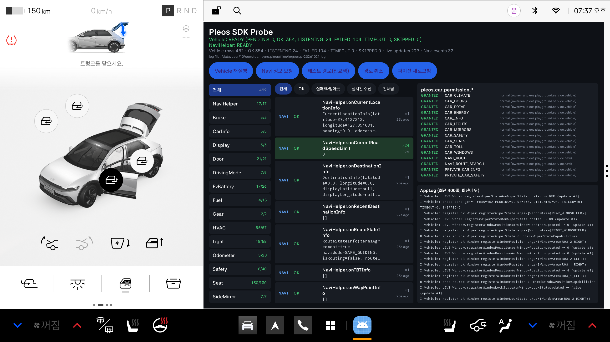

# Pleos Connect 차량용 앱 (가칭)

> 현대자동차그룹 차량용 앱 개발 공모전 출품 예정 앱. **현재 단계: M1 — SDK Probe** (앱 아이디어 확정 전).
> 앱 이름·한 줄 소개·APK 위치는 아이디어 확정 후 채운다 (제출 형식은 [CLAUDE.md](CLAUDE.md) §2).

지금 들어 있는 앱은 **Pleos SDK Probe**다. Vehicle SDK 전 도메인(20개)의 Capability/Get/Callback과 NaviHelper 이벤트를 실제로 호출해서 화면에 실시간으로 보여주고, 모든 결과를 로그로 남긴다.
실측 결과는 [docs/sdk-probe-results.md](docs/sdk-probe-results.md), API별 전체 표는 [docs/probe-table.md](docs/probe-table.md)에 있다.



## 테스트 환경

| 항목 | 값 |
|---|---|
| 대상 | Android Automotive OS, **Pleos Connect Emulator 2.1.0** (API 34, x86_64) |
| 앱 | Kotlin 2.0.21, Jetpack Compose, minSdk 28 / targetSdk 34 / compileSdk 35 |
| 빌드 | Gradle 8.13 (wrapper), AGP 8.13.0, **JDK 17 이상** (Android Studio 내장 JBR 21 사용) |
| SDK | `ai.pleos.playground:Vehicle:2.3.2`, `vehicle-data:1.1.11`, `NaviHelper:3.0.5` (Pleos Nexus) |

## 다른 컴퓨터에서 이어서 작업하기

### 1. 클론 + 커밋 identity (블라인드 심사 규칙)

```bash
git clone https://github.com/SYNC-Dongihwa/pleos-app.git
```

커밋 author에 실명·개인 메일이 들어가면 안 된다. 클론한 뒤 **이 repo에만** 익명 identity를 설정한다 (repo-local 설정은 clone으로 따라오지 않음).

```bash
git config user.name "SYNC-Dongihwa"
```

```bash
git config user.email "sync-dongihwa@users.noreply.github.com"
```

### 2. Android Studio / JDK

- Android Studio 최신 버전 설치 → Android SDK Platform 34·35, Build-Tools, Emulator, Platform-Tools.
- 터미널에서 빌드할 때는 JDK 17+가 필요하다. Android Studio 내장 JBR을 쓰면 된다 (Windows 기본 경로 `C:\Program Files\Android\Android Studio\jbr`).
- `local.properties`는 커밋하지 않는다. Android Studio로 열면 자동 생성되고, CLI만 쓰면 `ANDROID_HOME` 환경변수로 충분하다.

### 3. Pleos Connect Emulator 설치

공식 방법 (CLAUDE.md §3):
1. Android Studio → Settings → Languages & Frameworks → Android SDK → **SDK Update Sites** → `+`
   - Name: `Pleos Connect System Image`
   - URL (Windows/Linux): `https://nexus-playground.pleos.ai/repository/raw-releases/connect-avd/2.x/crp-sys-img.xml`
   - URL (Mac): `https://nexus-playground.pleos.ai/repository/raw-releases/connect-avd/2.x/crp-arm64-sys-img.xml`
2. SDK Platforms → Show Package Details → Android 14 (API 34) → **Pleos Connect v2.1.0 APIs** 설치 (약 4.1 GB 다운로드, 압축 해제 후 약 19.6 GB). 설치하면 42dot SDK License에 동의하는 것이다.
3. Device Manager → Create Device → **Automotive → Pleos Connect v2.1.0** → API 34 이미지 선택 → Advanced: Boot **Cold**, RAM **4 GB**.

> 첫 번째 PC에서는 SDK Manager 대신 수동으로 설치했다: 위 XML의 `crp_car_emulator.zip`을 받아 SHA-1(`b4f858d5bcc6c71506d7edfc872bcb9e5a11acaa`)을 확인하고,
> `$ANDROID_HOME/system-images/android-34/pleos_car_emulator/x86_64/`에 풀었다(zip 안의 `crp_avd_out_x86_64/` 폴더 이름을 `x86_64`로 변경). 공식 방법이 더 간단하다.

### 4. 빌드 · 설치 · 실행

```bash
./gradlew :app:installDebug
```

```bash
adb shell am start -n com.teamsync.pleos/.MainActivity
```

Windows PowerShell이면 `.\gradlew.bat :app:installDebug`. `JAVA_HOME`이 JDK 11 이하로 잡혀 있으면 빌드가 실패하므로 JBR 경로로 바꾼다.
Probe는 실행 직후 자동으로 전 도메인을 조사한다(약 5초). 상단 버튼: Vehicle 재실행 / Navi 정보 요청 / 테스트 경로(판교역) / 경로 취소 / 퍼미션 새로고침.

### 5. Virtual Console (차량 상태 조작)

```bash
adb forward tcp:8088 tcp:8088
```

PC 브라우저에서 `http://127.0.0.1:8088/` → 화면의 Gear·Climate·Body 패널, 또는 **Emulation Controls**(SOC, 주행가능거리, 경고등 등 48개 항목)에서 값을 바꾸면 Probe의 LIVE 행이 초록색으로 깜빡이며 갱신된다.
⚠️ 기어를 D로 두면 앱이 "주행 중에는 사용할 수 없습니다"로 가려진다 (DO 미선언). 화면을 보려면 P로 돌린다.

### 6. 로그 보기

로그 태그는 모두 `PLEOS/` 접두사다 (`PLEOS/Vehicle`, `PLEOS/Navi`, `PLEOS/Perm`, `PLEOS/App`, `PLEOS/UI`). `adb logcat -s 'PLEOS/*'`는 와일드카드가 지원되지 않아 동작하지 않는다.

```bash
adb logcat -v time | grep "PLEOS/"
```

```bash
adb logcat -v time -s PLEOS/Vehicle PLEOS/Navi PLEOS/Perm PLEOS/App PLEOS/UI
```

앱 내부 로그 파일 (AAOS 에뮬레이터의 앱 사용자는 **user 10**, 날짜는 에뮬레이터 시간대 PDT 기준):

```bash
adb exec-out run-as com.teamsync.pleos --user 10 cat files/logs/app-20261021.log > logs/probe.log
```

```bash
python -X utf8 tools/summarize_probe_log.py logs/probe.log > docs/probe-table.md
```

`logs/`는 `.gitignore` 대상이다.

## 구조

```
├─ CLAUDE.md                 # 작업 규칙·공모전 정보·진행 로그(§9) — 작업 시작 전에 먼저 읽기
├─ README.md
├─ app/src/main/java/com/teamsync/pleos/
│  ├─ log/AppLog.kt          # 공통 로그 래퍼 (logcat + filesDir/logs 롤링 파일 + 화면용 tail)
│  ├─ vehicle/VehicleErrors.kt  # 난독화된 Vehicle 예외에서 ErrorCode 추출
│  ├─ probe/                 # VehicleProbe(리플렉션 전수 호출), NaviProbe, PermissionReport, ViewModel
│  └─ ui/ProbeScreen.kt      # Probe 화면 (Compose)
├─ docs/                     # 실측 결과, 결과표, 스크린샷
├─ tools/summarize_probe_log.py
└─ apk/                      # 제출용 release APK 위치 (아직 없음)
```

## 비밀정보

release 키스토어(`*.jks`), `keystore.properties`, API 키, Playground 클라이언트 시크릿은 절대 커밋하지 않는다 (`.gitignore` 처리됨). 키는 `local.properties` 또는 환경변수에서 `BuildConfig`로 주입한다.
