# 내 차 튜토리얼

> **처음 타는 차에서 주유구·전조등·김서림 같은 기능을 직접 조작하면, 차가 실제로 바뀌었는지 Vehicle SDK로 확인해 주는 인터랙티브 튜토리얼.**
> 현대자동차그룹 차량용 앱 개발 공모전(Pleos App Market) 출품작 · 앱 카테고리 Mobility Services

**시작은 이 장면이었다.** 친구가 신형 쏘나타를 새로 샀는데, 주유소에서 **주유구를 못 열었다.** 예전 차와 여는 방식이 달랐기 때문이다.
설명서를 뒤지거나 검색해도 내 차에 맞는 답을 바로 찾기 어렵다. 이런 기능은 평소엔 몰라도 되다가 **필요한 순간에야** 찾게 된다.
그래서 와이퍼·전조등 같은 기본 조작뿐 아니라 주유구·충전구·보닛·김서림·창문 잠금처럼 "그 순간"에 필요한 기능을 **상황별 코스**로 미리 직접 눌러 보게 했다.

- 사용 장면: 차를 바꾼 직후(신형·다른 브랜드), 신차 출고 첫날, 렌터카·카셰어링 첫 탑승, 초보·장롱면허 운전자
- 정차 중(기어 P)에만 진행하고, 화면 문구와 **Pleos TextToSpeech(온디바이스)** 음성으로 안내한다.
- 완료는 화면 버튼이 아니라 **Vehicle SDK 콜백으로 받은 실제 상태 전이**로만 판정한다. 바꾼 상태를 원래대로 되돌렸는지까지 확인한다.

## 이렇게 써요

> 아래는 모두 **Pleos Connect Emulator 2.1.0에서 실제로 실행한 화면**이다 (가짜 화면·목업 없음). 차량 조작은 Virtual Console로 했다.
> 왼쪽은 차량 클러스터(기어·차량 상태), 오른쪽이 앱이다.

### 1. 새 차에 타면, 먼저 인사해요

차를 받은 첫날 앱을 열거나 **운전석 문을 여는 순간** 환영 음성이 나온다.
"처음 타는 차의 기능을 하나씩 직접 조작해 보면서 익혀 볼게요."

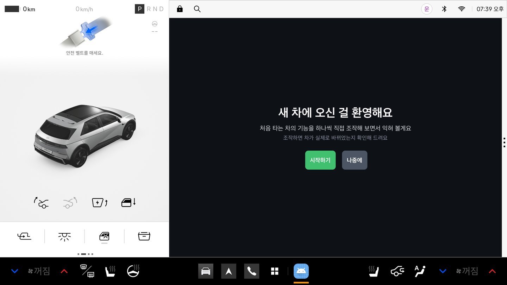

### 2. 지금 필요한 상황을 골라요

정차(기어 P)를 확인하고, 상황별 코스를 보여준다: **기본 조작 · 주유·충전 · 비·김서림 · 추위·공조 · 아이·야간** (+ 전체 24단계).
코스마다 이 차가 상태를 알려 주지 않는 기능 수("이 차 미지원")를 자동으로 세서 보여준다. 차종이 바뀌어도 앱을 고칠 필요가 없다.

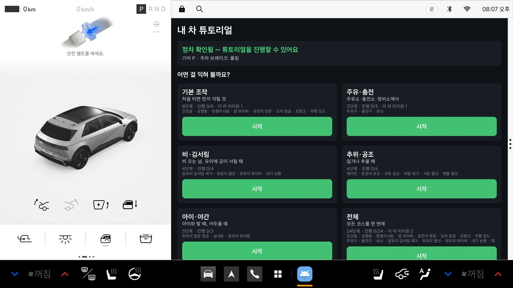

### 3. 주유구가 어디였더라? — 주유·충전 코스

주유소에 들어가기 전에 미리 해 본다. 차가 주유구 상태를 알려 주면 주유구, 전기차라면 충전구를 연다 (주유구는 AAOS 표준 `FUEL_DOOR_OPEN` — 내연기관 실차 검증은 아직).
이 에뮬레이터 차량은 전기차라 주유구 상태를 주지 않는다 → 앱이 "주유구는 이 차에서 확인할 수 없어 넘어갈게요"라고 말하고 **충전구**로 넘어간다. 이어서 보닛까지.

| 안내 | 코스 결과 |
|---|---|
| 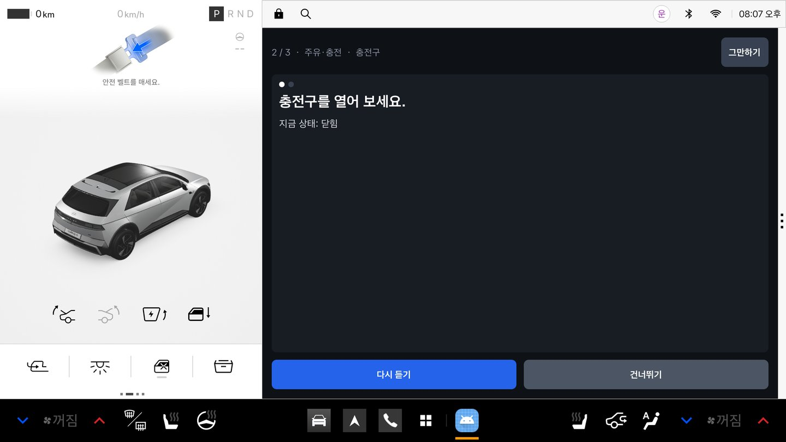 | 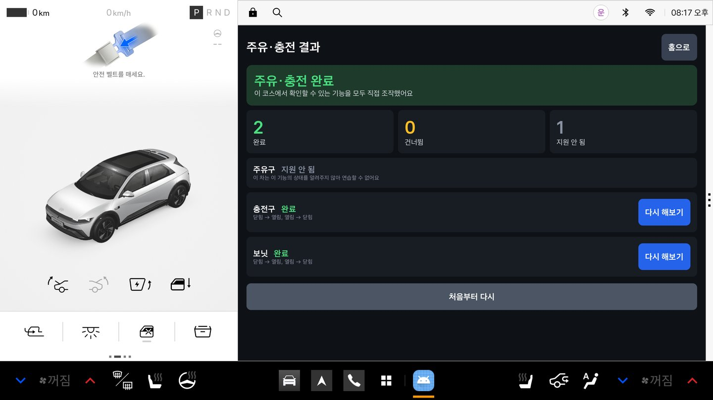 |
| "충전구를 열어 보세요." 덮개가 실제로 열리면(`닫힘 → 열림`) 다음으로 | 주유구는 '지원 안 됨', 충전구·보닛은 완료 → "주유·충전 완료" |

### 4. 직접 해 보면, 차가 바뀐 걸 확인해요

"전조등을 켜 보세요." 운전자가 실제로 레버를 돌리면 차량에서 `꺼짐 → 켜짐` 신호가 들어오고, 앱이 그걸 보고 다음으로 넘어간다.
화면 버튼을 누르는 게 아니라 **차가 정말 바뀌어야** 진행된다. 마지막엔 "원래대로 꺼 주세요"까지 확인해서, 튜토리얼이 끝난 뒤 차 상태가 바뀐 채로 남지 않는다.

| 안내 | 조작 → 확인 |
|---|---|
| 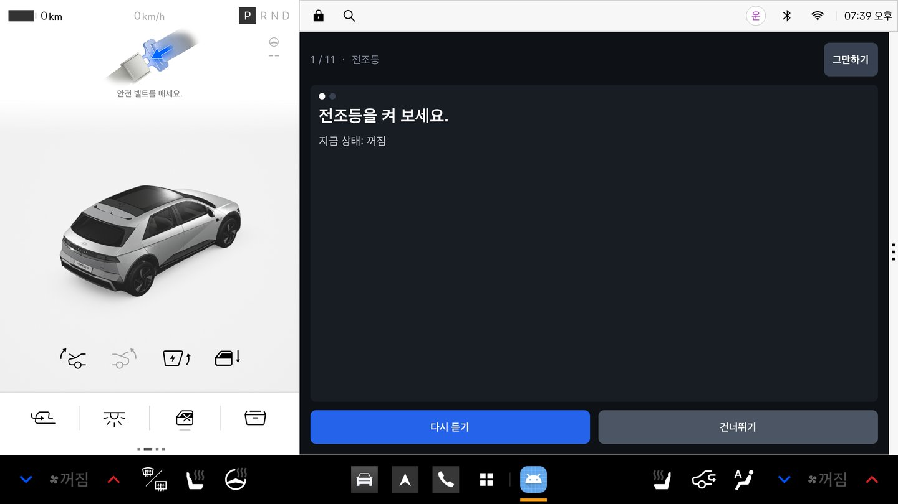 | 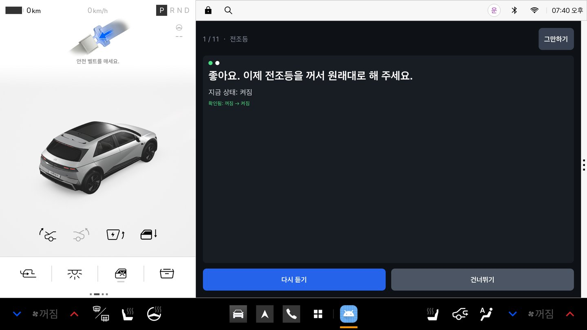 |
| "전조등을 켜 보세요." · 지금 상태: 꺼짐 | 왼쪽 클러스터의 차에도 불이 들어오고, 앱은 "확인됨: 꺼짐 → 켜짐" → "이제 꺼서 원래대로" |

### 5. 어디 있는지 모르면, 위치를 알려줘요

20초 동안 아무 변화가 없으면 버튼 위치를 음성과 화면으로 한 번 더 알려준다. 모르면 언제든 건너뛸 수 있다.

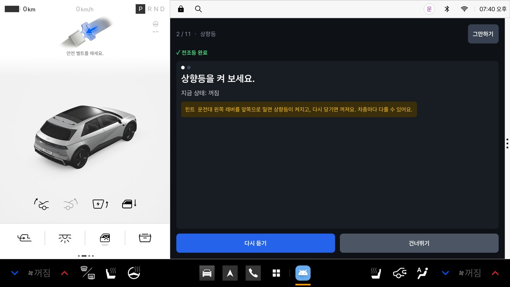

### 6. 출발하려고 하면, 바로 멈춰요

정차 중에만 쓰는 앱이라 기어를 D로 바꾸는 순간 멈추고 "차가 움직일 수 있는 상태라 잠시 멈출게요"라고 말한다 (화면은 시스템이 가린다).
다시 P로 돌리면 하던 단계부터 이어서 한다.

| 기어 D | 다시 P |
|---|---|
| 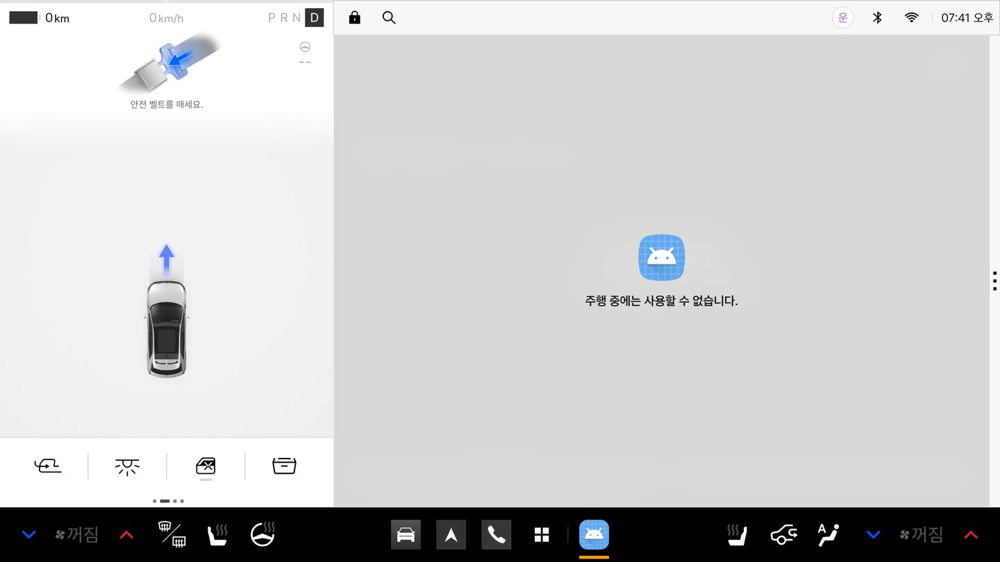 | 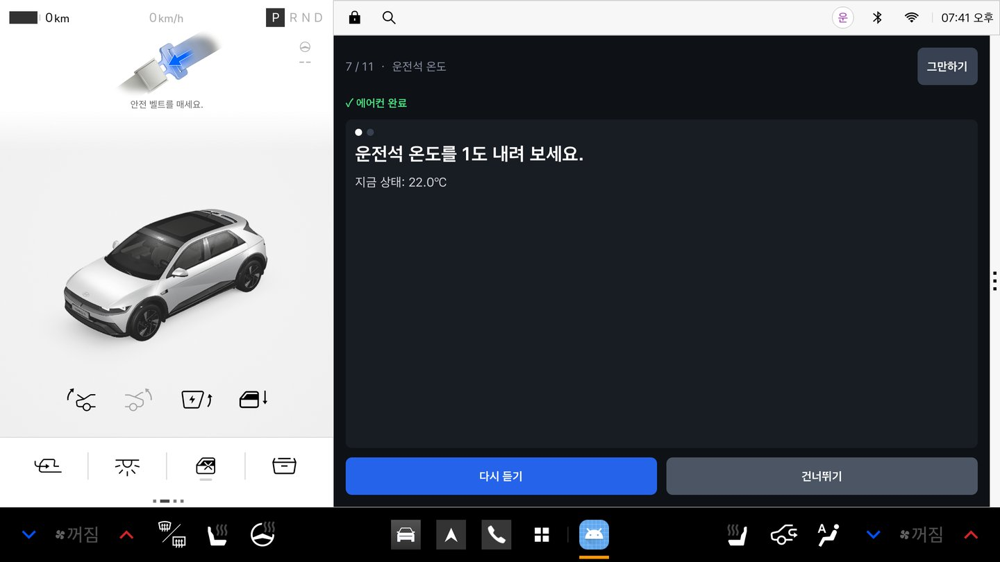 |

### 7. 끝나면, 무엇을 익혔는지 보여줘요

완료·건너뜀·지원 안 됨 개수와 단계마다 **실제로 관찰한 변화**(예: `22.0℃ → 21.0℃, 21.0℃ → 22.0℃`)를 남긴다. 다시 해보고 싶은 단계만 골라서 할 수 있고, 지원되는 기능을 모두 해내면 "내 차 마스터" 배지를 준다.
진행 상황은 저장돼서 중간에 꺼도 다음에 이어서 할 수 있다.

| 결과 | 단계별 확인 근거 |
|---|---|
| 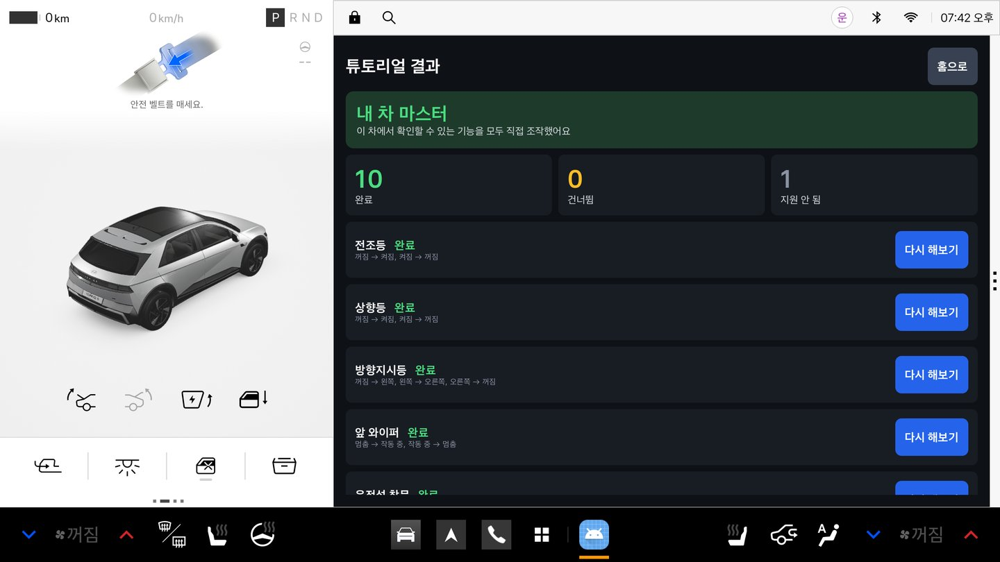 | 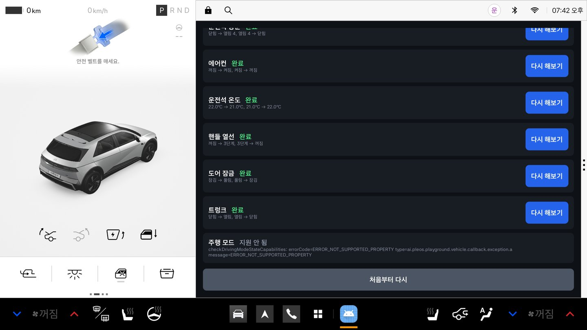 |

### 개발자 패널 (숨김)

홈 제목을 3초 안에 5번 누르면 열린다. 앱이 받고 있는 차량 신호의 원시 값, 기능별 지원 여부(capability), 정차 게이트, 음성 엔진 상태, 최근 오류를 그대로 보여준다 — 현장에서 "왜 안 넘어가지?"를 바로 확인하기 위한 화면.

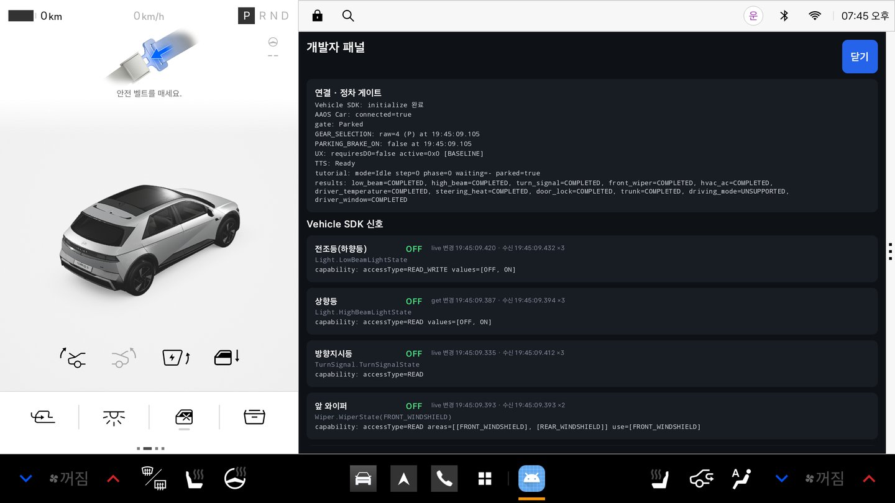

## APK

**[apk/SYNC_MyCarTutorial_release.apk](apk/SYNC_MyCarTutorial_release.apk)** — release 빌드, APK Signature Scheme v3 서명 (versionName 1.0.0)

```bash
adb install -r apk/SYNC_MyCarTutorial_release.apk
```

## 주요 기능

| 기능 | 내용 |
|---|---|
| 새 차 첫날 오프닝 | 첫 실행 또는 **운전석 문이 열리는 순간** 환영 음성·화면 → "시작하기"로 튜토리얼 시작. 실내등 연출은 차량 제어 퍼미션(`CONTROL_CAR_LIGHTS`)이 승인됐을 때만 동작 |
| 상황별 코스 (24단계) | **기본 조작**(전조등·상향등·방향지시등·앞 와이퍼·운전석 창문·도어 잠금·트렁크·주행 모드) · **주유·충전**(주유구·충전구·보닛) · **비·김서림**(앞유리 김서림 제거·뒷유리 열선·뒷유리 와이퍼·내기 순환) · **추위·공조**(에어컨·운전석 온도·오토 공조·바람 세기·시트 열선·핸들 열선) · **아이·야간**(창문 잠금·실내등·뒷좌석 독서등) + 전체 |
| 상태 전이 판정 | 예: 전조등 `꺼짐 → 켜짐`(콜백) 관찰 → "이제 꺼서 원래대로" → `켜짐 → 꺼짐` 관찰 → 완료. 시작할 때 이미 켜져 있으면 "꺼 보세요"부터 |
| 위치 힌트 · 건너뛰기 | 20초 동안 변화가 없으면 위치 힌트 음성 한 번. 건너뛰기는 항상 가능하고 '건너뜀'으로 기록 |
| 차종별 자동 처리 | capability가 없는 기능은 '이 차량은 지원하지 않음'으로 표시하고 넘어감 (사유 로그). 에뮬레이터에선 주행 모드가 해당 |
| 주행 전환 일시정지 | 기어가 P가 아니게 되면 즉시 멈추고 음성으로 알림, P로 돌아오면 이어서 |
| 결과 · 이어서 하기 | 완료·건너뜀·지원 안 됨 개수, 단계별 확인 근거, 다시 해보기, "내 차 마스터" 배지. 진행 상황은 저장돼 앱을 다시 열어도 이어서 |
| 개발자 패널 | 홈 제목을 3초 안에 5번 탭 — 구독 중인 신호의 실시간 원시 값, capability 결과, 튜토리얼·TTS 상태, 퍼미션, 최근 오류 50개 |

## 테스트 환경 및 필요한 설정

| 항목 | 값 |
|---|---|
| 대상 | Android Automotive OS — **Pleos Connect Emulator 2.1.0** (API 34, x86_64) + Virtual Console |
| 앱 | Kotlin 2.0.21, Jetpack Compose, minSdk 28 / targetSdk 34 / compileSdk 35, 패키지 `com.teamsync.pleos` |
| SDK | Pleos `Vehicle:2.3.2`(+`vehicle-data:1.1.11`), `TextToSpeech:3.3.1` (Pleos Nexus), AAOS Car API(`GEAR_SELECTION`·`PARKING_BRAKE_ON`·`FUEL_DOOR_OPEN`·`EV_CHARGE_PORT_OPEN`·주행 규제) — Pleos SDK에 없는 기어·주유구는 문서 안내대로 AAOS 표준 속성 사용 |
| 빌드 | Gradle 8.13 wrapper, AGP 8.13.0, **JDK 17 이상** (Android Studio 내장 JBR) |
| 퍼미션 | `pleos.car.permission.CAR_LIGHTS · CAR_WINDOWS · CAR_CLIMATE · CAR_DOORS · CAR_DRIVE · CAR_SEATS · TTS_SERVICE`, `android.car.permission.CAR_POWERTRAIN · CAR_ENERGY_PORTS` — 모두 normal, 런타임 요청 없음 |
| 네트워크·계정 | 필요 없음 (TTS 온디바이스 모드) |

### 에뮬레이터 설치 (공식 방법)

1. Android Studio → Settings → Languages & Frameworks → Android SDK → **SDK Update Sites** → `+`
   - Name: `Pleos Connect System Image`
   - URL (Windows/Linux): `https://nexus-playground.pleos.ai/repository/raw-releases/connect-avd/2.x/crp-sys-img.xml`
   - URL (Mac): `https://nexus-playground.pleos.ai/repository/raw-releases/connect-avd/2.x/crp-arm64-sys-img.xml`
2. SDK Platforms → Show Package Details → Android 14 (API 34) → **Pleos Connect v2.1.0 APIs** 설치 (약 4.1 GB)
3. Device Manager → Create Device → **Automotive → Pleos Connect v2.1.0** → API 34 → Advanced: Boot **Cold**, RAM **4 GB**

### Virtual Console (차량 상태 조작)

```bash
adb forward tcp:8088 tcp:8088
```

브라우저에서 `http://127.0.0.1:8088/` → **Emulation Controls**의 카드로 차량 상태를 바꾼다. 스크립트 조작: [tools/vc-helper.js](tools/vc-helper.js) (카드 단위), [tools/vc-demo.js](tools/vc-demo.js) (시연 전체 자동).

## 실행 방법

1. 에뮬레이터를 켜고 APK를 설치한다 (위 `adb install`). 직접 빌드하려면 아래 "빌드".
2. 앱 "내 차 튜토리얼"을 실행 → 오프닝 → **시작하기**(기본 조작 코스) 또는 **나중에** → 홈에서 코스 카드의 **시작**. 기어가 P가 아니면 시작 버튼이 막혀 있다.
3. 화면·음성 안내에 따라 Virtual Console에서 해당 기능을 조작한다. 처음 값이 다르면 앱이 문구를 바꿔 안내한다(예: 이미 켜져 있으면 "꺼 보세요" → "다시 켜 주세요"). 조작 순서:

| 코스 | 단계 | 콘솔 카드 → 조작 |
|---|---|---|
| 기본 조작 | 전조등 | Exterior Lights Mode → Low beam → Off |
| | 상향등 | High Beam → On → Off |
| | 방향지시등 | Turn Signal State → Blink left → Blink right → Off |
| | 앞 와이퍼 | Windshield Wiper Switch (front) → Low → Off |
| | 운전석 창문 | Window Position (front_left) → 40 → 0 |
| | 도어 잠금 | Door Lock → Unlock → Lock |
| | 트렁크 | Trunk / Frunk Position (**trunk**) → Open → Close |
| | 주행 모드 | 콘솔 카드 없음, 에뮬레이터 미지원 → 앱이 '지원 안 됨'으로 넘어감 |
| 주유·충전 | 주유구 | 에뮬레이터는 전기차라 `FUEL_DOOR_OPEN` 없음 → 자동으로 '지원 안 됨' (차가 이 속성을 주면 동작 — 내연기관 실차는 미검증) |
| | 충전구 | Charge Port → Open → Closed |
| | 보닛 | Trunk / Frunk Position (**frunk**) → Open → Close |
| 비·김서림 | 앞유리 김서림 제거 | Defroster (front_defroster_on) → On → Off |
| | 뒷유리 열선 | Defroster (rear_defroster_on) → On → Off |
| | 뒷유리 와이퍼 | Windshield Wiper Switch (rear) → Low → Off |
| | 내기 순환 | Air Recirculation → Recirculate → Fresh |
| 추위·공조 | 에어컨 | Air Conditioning → On → Off |
| | 운전석 온도 | Target Temperature (driver) → 원래보다 1℃ 낮게 → 원래 값 |
| | 오토 공조 | HVAC Auto → On → Off |
| | 바람 세기 | Fan Speed → 한 칸 올림 → 원래 값 |
| | 시트 열선 | Seat Temperature (driver) → H2 → Off |
| | 핸들 열선 | Steering Wheel Heat → High → Off |
| 아이·야간 | 창문 잠금 | Window Lock (**all**) → Lock → Unlock |
| | 실내등 | Cabin Lights Switch → On → Off |
| | 뒷좌석 독서등 | Reading Lights (rear_left) → 안내대로 On/Off (에뮬레이터는 실내등을 켜면 독서등도 같이 켜질 수 있음) |

- 일시정지: 아무 단계에서 Gear Selection → D (앱이 멈추고 음성 안내, 시스템이 화면을 가림) → P (약 1초 뒤 이어서).
- 오프닝 다시 보기: `adb shell pm clear --user 10 com.teamsync.pleos` 후 실행, 또는 튜토리얼 시작 전 홈에서 콘솔 Door Position(front_left) → Open.
- 시연 영상·PT 시나리오: [docs/demo-scenario.md](docs/demo-scenario.md)

## 빌드

```bash
./gradlew :app:assembleDebug
```

```bash
./gradlew :app:testDebugUnitTest
```

```bash
./gradlew :app:assembleRelease
```

- Windows PowerShell은 `.\gradlew.bat …`. `JAVA_HOME`은 JDK 17+ (예: `C:\Program Files\Android\Android Studio\jbr`).
- **release 서명**: repo 루트에 `keystore.properties`(커밋 금지, `.gitignore` 처리)를 두면 서명된다. 없으면 서명 없이 빌드된다.
  ```properties
  storeFile=<키스토어 절대 경로>
  storePassword=<비밀번호>
  keyAlias=<별칭>
  keyPassword=<비밀번호>
  ```
- debug 빌드는 오프닝 실내등 연출 검증을 위해 `CONTROL_CAR_LIGHTS`를 추가 선언한다 (`app/src/debug/AndroidManifest.xml`). release에는 없다.

## 로그로 확인하기

```bash
adb logcat -v time | grep "SYNC/"
```

- 태그: `SYNC/Vehicle`(capability·구독·값), `SYNC/Car`(기어·주차 브레이크·주행 규제), `SYNC/Gate`, `SYNC/Tutorial`(판정), `SYNC/Opening`, `SYNC/Speech`, `SYNC/Progress`, `SYNC/UI`
- 판정 근거 예: `SYNC/Tutorial: JUDGE low_beam phase=1/2 goal='원래 값에서 바뀜' original=OFF phaseStart=OFF OFF→ON (live) → 충족`
- 앱 내부 로그 파일 (AAOS 앱 사용자 = user 10): `adb exec-out run-as com.teamsync.pleos --user 10 ls files/logs`

## 구조

```
├─ CLAUDE.md                 # 현재 상태·결정·SDK 메모·퍼미션 체크리스트·알려진 이슈
├─ apk/                      # 제출용 release APK
├─ app/src/main/java/com/teamsync/pleos/
│  ├─ PleosApp.kt · AppGraph.kt   # 프로세스 단위 초기화 (SDK 구독은 여기서 한 번만)
│  ├─ MainActivity.kt        # 오프닝 / 홈 / 튜토리얼 / 결과 / 개발자 패널 전환
│  ├─ vehicle/               # VehicleStateRepository(capability → get → 구독 → StateFlow + 변화 이벤트)
│  ├─ car/                   # AaosCarMonitor(주행 규제·GEAR_SELECTION·PARKING_BRAKE_ON), ParkingGate
│  ├─ tutorial/              # TutorialSteps(단계 데이터), TutorialEngine(판정 상태 기계), TutorialController, ProgressStore
│  ├─ opening/               # OpeningDirector(첫 실행·운전석 문 열림 → 환영)
│  ├─ voice/SpeechGuide.kt   # Pleos TTS 온디바이스
│  ├─ log/AppLog.kt          # 공통 로그 (SYNC/ 태그, logcat + 롤링 파일 + 최근 오류 50개)
│  └─ ui/                    # Compose 화면
├─ app/src/test/             # 단위 테스트 (게이트, Area 선택, 튜토리얼 엔진, 오프닝 조건)
├─ docs/                     # 시연 시나리오, 공모전 규정, 이전 실측 기록
└─ tools/                    # Virtual Console 조작 스크립트
```

## 다른 컴퓨터에서 이어서 작업하기

```bash
git clone https://github.com/SYNC-Dongihwa/pleos-app.git
```

블라인드 심사 규칙상 커밋 author에 실명·개인 메일이 들어가면 안 된다. 클론한 뒤 **이 repo에만** 익명 identity를 설정한다 (repo-local 설정은 clone으로 따라오지 않음).

```bash
git config user.name "SYNC-Dongihwa"
```

```bash
git config user.email "sync-dongihwa@users.noreply.github.com"
```

release 서명용 키스토어와 `keystore.properties`는 git에 없다 — 같은 서명으로 업데이트하려면 두 파일을 안전한 경로로 따로 옮긴다.

## 비밀정보

release 키스토어(`*.jks`), `keystore.properties`, API 키, Playground 클라이언트 시크릿은 절대 커밋하지 않는다 (`.gitignore`).
